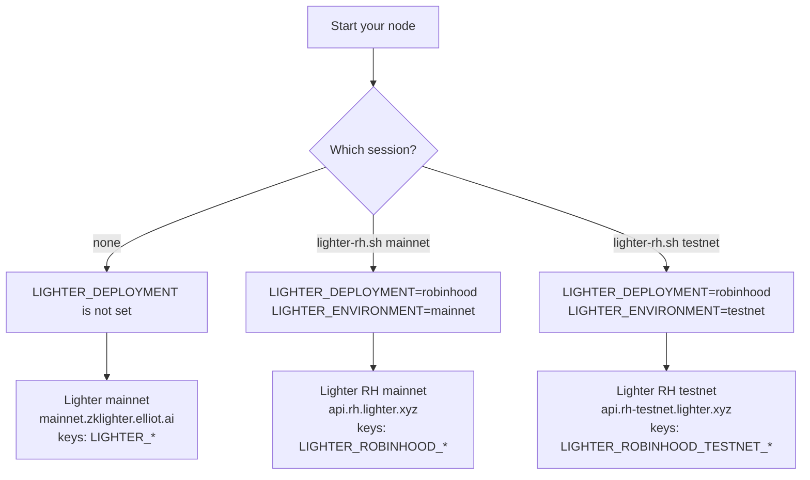

# lighter-rh

One command that points `nautilus-lighter` 0.67.0 at **Lighter on Robinhood Chain**. Each network has its own session.

Files: `lighter-rh.sh` (the tool), `lighter-rh.test.sh` (its self-check), this README. No file contains a key.

## Quick start

```bash
./lighter-rh.sh mainnet
```

```bash
./lighter-rh.sh testnet
```

Each command opens a new shell. Type `exit` to go back to main Lighter.

To run one command only, put it after the network:

```bash
./lighter-rh.sh testnet cargo run --example lighter-data-tester --features examples
```

## How the switch works



The session sets two variables. Your node reads them and gives them to the adapter config. The adapter then selects the URL, the chain ID, the venue and the credential prefix.

## What changes per target

| | Lighter mainnet | Lighter testnet | RH mainnet | RH testnet |
|---|---|---|---|---|
| How to select | no session | no session, `LIGHTER_ENVIRONMENT=testnet` | `lighter-rh.sh mainnet` | `lighter-rh.sh testnet` |
| REST host | `mainnet.zklighter.elliot.ai` | `testnet.zklighter.elliot.ai` | `api.rh.lighter.xyz` | `api.rh-testnet.lighter.xyz` |
| WebSocket | `wss://<host>/stream` | same pattern | same pattern | same pattern |
| Chain ID for signing | 304 | 300 | 466324 | 300 |
| Settlement currency | USDC | USDC | USDG | USDG |
| Venue | `LIGHTER` | `LIGHTER` | `LIGHTER_ROBINHOOD` | `LIGHTER_ROBINHOOD` |
| Credential prefix | `LIGHTER_` | `LIGHTER_TESTNET_` | `LIGHTER_ROBINHOOD_` | `LIGHTER_ROBINHOOD_TESTNET_` |
| Active markets (10 Nov 2026) | 226 | not checked | 98 | 3 |

## Environment variables

### Set by the session

| Variable | `mainnet` session | `testnet` session | Who reads it |
|---|---|---|---|
| `LIGHTER_DEPLOYMENT` | `robinhood` | `robinhood` | `lighter-flatten`, your node |
| `LIGHTER_ENVIRONMENT` | `mainnet` | `testnet` | `lighter-flatten`, your node |
| `LIGHTER_RH_SESSION` | `mainnet` | `testnet` | You (prompt, scripts) |
| `LIGHTER_RH_HTTP_URL` | `https://api.rh.lighter.xyz` | `https://api.rh-testnet.lighter.xyz` | You (`curl`) |
| `LIGHTER_RH_WS_URL` | `wss://api.rh.lighter.xyz/stream` | `wss://api.rh-testnet.lighter.xyz/stream` | You |

### Credentials (optional, from your file)

Public data needs no credentials. To trade, put these three lines in the file of the network.

| In `mainnet.env` | In `testnet.env` | Value |
|---|---|---|
| `LIGHTER_ROBINHOOD_API_KEY_INDEX` | `LIGHTER_ROBINHOOD_TESTNET_API_KEY_INDEX` | 0 to 254 |
| `LIGHTER_ROBINHOOD_API_SECRET` | `LIGHTER_ROBINHOOD_TESTNET_API_SECRET` | Hex private key of the API key. Not the wallet key. |
| `LIGHTER_ROBINHOOD_ACCOUNT_INDEX` | `LIGHTER_ROBINHOOD_TESTNET_ACCOUNT_INDEX` | Account number from registration |

### Removed by the session

| Variable | Why |
|---|---|
| Robinhood credentials from the parent shell | The session takes credentials from the file only |
| Credentials of the other Robinhood network | A testnet session must not hold the mainnet key |

### Optional input

| Variable | Default | Use |
|---|---|---|
| `LIGHTER_RH_DIR` | `~/.config/lighter-rh` | Directory of the credential files |

## Setup

1. Make the script executable: `chmod +x lighter-rh.sh`.
2. Optional: create `~/.config/lighter-rh/mainnet.env` or `testnet.env`, then run `chmod 600` on it. The script refuses a file with a different mode.
3. Add the code below to your node.

## Node code

The adapter clients take the deployment and the environment from the config, not from the environment variables. Add this to your node:

```rust
// A variable that is not set gives the adapter default: Lighter, mainnet.
fn from_env<T: std::str::FromStr + Default>(name: &str) -> Result<T, T::Err> {
    std::env::var(name).map_or(Ok(T::default()), |s| s.parse())
}

let lighter_deployment: LighterDeployment = from_env("LIGHTER_DEPLOYMENT")?;
let lighter_environment: LighterEnvironment = from_env("LIGHTER_ENVIRONMENT")?;
let venue = match lighter_deployment {
    LighterDeployment::Lighter => LIGHTER,
    LighterDeployment::Robinhood => LIGHTER_ROBINHOOD,
};
```

Then call `.environment(lighter_environment).deployment(lighter_deployment)` on the config builder. Use `venue` for the client ID and the instrument IDs.

## Cautions

- **Outside a session, the node connects to Lighter mainnet.** Look at the line `lighter-rh: testnet session, …` before you trade.
- **`.env` files.** The crate examples call `dotenvy::dotenv()`. A `.env` file in the current directory can bring back a variable that the session removed.
- **Mainnet start.** On mainnet, the execution client sends `ApproveIntegrator` and binds the referral code `NAUTILUS` at start. On testnet it does not.
- **Markets.** RH testnet has three markets: SOL, ETH and BTC perps. A `market_id` is not the same across deployments.
- **Account ID.** It must start with `LIGHTER_ROBINHOOD-` on the two Robinhood networks.
- **Credential file.** The script runs the file with `source`. Put variable lines only in it.

## Test

```bash
./lighter-rh.test.sh
```

The test uses dummy values and no network. It prints `ok`.
